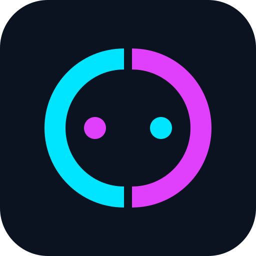

<!-- Continuum product README — keep badge contract in scripts/lib/readme_badges.py -->

  

<h1 align="center">Continuum Calendar</h1>

<strong>Your week, your devices, your rules — without a subscription.</strong>

  
  
  
  
  
  
  
  
  
  
  

## Pitch

Continuum is a free and open-source calendar for people who want Google when it's useful, local privacy when it's not, and the same agenda on phone and desktop without paying a Pro tax.

## Features

- Rolling week from today with explicit Open empty days
- Google Calendar sync with peer settings and local-event overlays
- CalDAV + ICS import/export alongside Google
- Compose Multiplatform tree under `kmp/` (hotkeys, Tasks, holidays, free slots)
- Desktop + Android FOSS apps under MIT
- Cyan + purple infinity brand mark — owned Continuum identity

## Quick start

1. Clone the repo and open it in Cursor.
2. Follow `docs/START_HERE.md` for the startup sequence.
3. Desktop: `apps/desktop` (Tauri) or `kmp/desktopApp` (CMP).
4. Android: `apps/mobile` FOSS flavor.

## Contributing

See [`CONTRIBUTING.md`](CONTRIBUTING.md). Agent workflow: `/bootstrap`, `/build`, `/verify`, `/ship` per [`docs/help/BATCH_COMMANDS.md`](docs/help/BATCH_COMMANDS.md).

## Security

See [`SECURITY.md`](SECURITY.md). Never commit secrets or `.env` files.

## License

MIT — see [`LICENSE`](LICENSE).

GitHub Pages demo: https://edwardlthompson.github.io/continuum-calendar/
