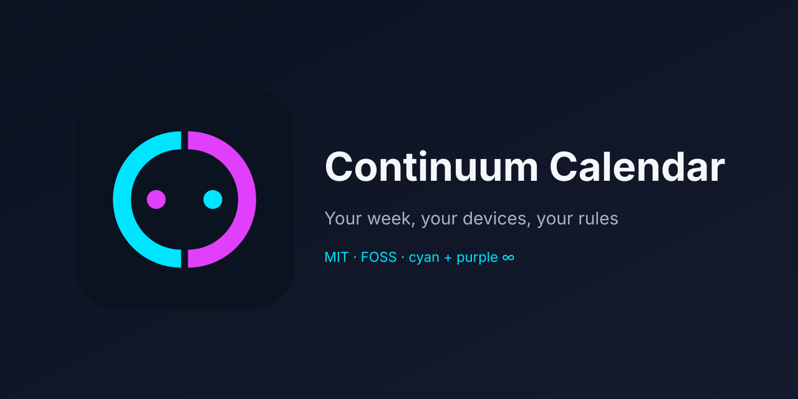
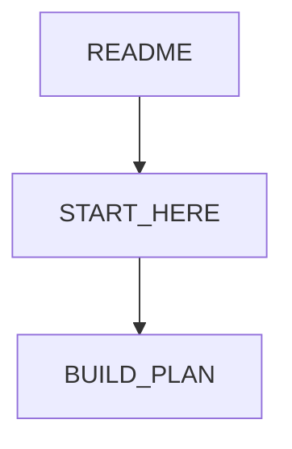
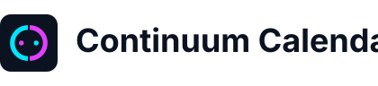

<!-- GENERATED by scripts/generate-project-readme.py — edit branding/product.json -->

  

<h1 align="center">Continuum Calendar</h1>

<strong>Your week, your devices, your rules — without a subscription.</strong>

  
  
  
  
  
  
  
  
  
  

  
  
  
  

## Pitch

Continuum is a free and open-source calendar for people who want Google when it’s useful, local privacy when it’s not, and the same agenda on phone and desktop without paying a Pro tax.

## Demo

  

> Add screenshots or a short demo GIF under `docs/images/` and link them here when available.

## Features

- Rolling week from today with explicit Open empty days
- Google Calendar sync with peer settings and local-event overlays
- CalDAV + ICS import/export alongside Google
- Desktop + Android FOSS apps under MIT
- Cyan + purple infinity brand mark — owned Continuum identity

## Quick start

1. Clone the repo and open it in Cursor.
2. Follow `docs/START_HERE.md` for the startup sequence.
3. Desktop: `apps/desktop` (Tauri) or `kmp/desktopApp` (CMP).
4. Android: `apps/mobile` FOSS flavor.

## For humans

Start with this README, then [`CONTRIBUTING.md`](CONTRIBUTING.md) and [`docs/BEST_PRACTICES.md`](docs/BEST_PRACTICES.md). The first-month playbook is [`docs/FIRST_30_DAYS.md`](docs/FIRST_30_DAYS.md).

## For agents

Read [`docs/START_HERE.md`](docs/START_HERE.md) and [`AGENTS.md`](AGENTS.md). In Cursor type `/tour` or `/bootstrap`. Any other IDE: ask the agent to read [`docs/help/TOUR.md`](docs/help/TOUR.md). `/coach` is the next recommended action.

## Install

Desktop and Android releases on GitHub Releases. Local: Node 20+ for Tauri; JDK 17+ for Android/KMP.

## Usage

Use `/bootstrap` / `/build` / `/verify` per `docs/help/BATCH_COMMANDS.md`. Regen brand icons: `python3 scripts/generate-infinity-mark.py`.

## Configuration

Copy [`.env.example`](.env.example) to `.env` for local secrets (never commit `.env`). Stack-specific config lives in the active `examples/` or app root after prune.

## Contributing

See [`CONTRIBUTING.md`](CONTRIBUTING.md). Prefer small PRs; follow Conventional Commits and the BUILD_PLAN labels (`AGENT` / `HUMAN` / `ADB` / `AUTO`). Status markers: 🔲 open · ✅ done · ❌ blocked.

## Security

See [`SECURITY.md`](SECURITY.md). Enable Dependabot alerts and follow [`docs/SECURITY_TRIAGE.md`](docs/SECURITY_TRIAGE.md) for weekly CVE triage.

## License

[MIT License](LICENSE) — see the license file for terms.

## Acknowledgments

Scaffolded with [agent-project-bootstrap](https://github.com/edwardlthompson/agent-project-bootstrap). Brand assets: [`branding/BRANDING.md`](branding/BRANDING.md). Design system: [`docs/BRAND.md`](docs/BRAND.md).

GitHub Pages demo: https://edwardlthompson.github.io/continuum-calendar/
