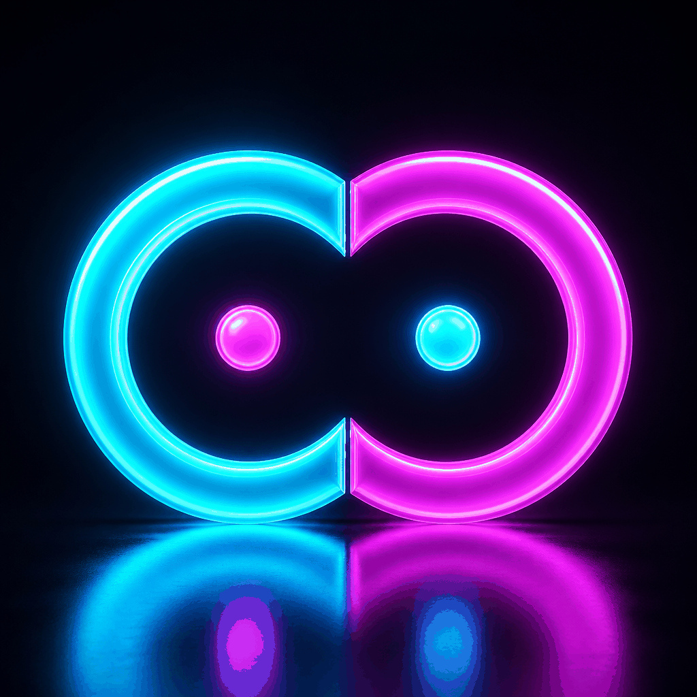

# Continuum Calendar (Android)

  

Private FOSS calendar for Android — Continuum branding on a [Fossify Calendar](https://github.com/FossifyOrg/Calendar) fork.

**Application id:** `org.continuumcalendar.app` (debug: `org.continuumcalendar.app.debug`)  
**Store version:** `1.0.0` / versionCode `26` (`gradle.properties`). Repo tags like `v2.1.0` are the bootstrap template — tag F-Droid builds `android-1.0.0`.

## Features

- Ad-free local calendar with CalDAV (including Google Calendar over CalDAV)
- Month, day, week, year, and agenda (event list) views
- Widgets and reminders
- Continuum rolling week and Open-day agenda
- `gplay` flavor only: optional desktop peer sync via Google Drive App Data (Custom Tabs OAuth, no GMS)

## Build

FOSS / F-Droid: `./gradlew :app:assembleFossRelease` (empty OAuth BuildConfig).  
Play / peer-sync: `assembleGplayRelease` with client ids in `apps/mobile/local.properties` — see `docs/GOOGLE_API_SETUP.md`.

## License & credits

- This Android tree is **GPL-3.0-only**. Combined work including Continuum modifications.
- Copyright: Fossify, Simple Mobile Tools, and Edward Thompson — [`NOTICE`](NOTICE), [`LICENSE`](LICENSE).
- Desktop, KMP, and docs stay **MIT** — see [`LICENSING.md`](../../LICENSING.md). They were **not** relicensed.
- Upstream: [FossifyOrg/Calendar](https://github.com/FossifyOrg/Calendar) and Fossify Commons.

Brand tokens and mark: [`docs/BRAND.md`](../../docs/BRAND.md).
